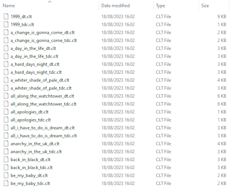
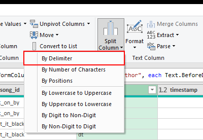
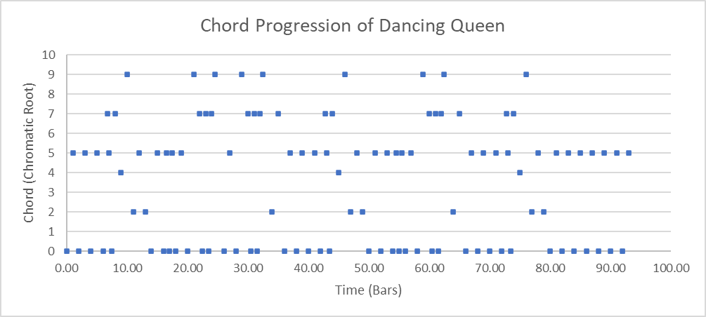
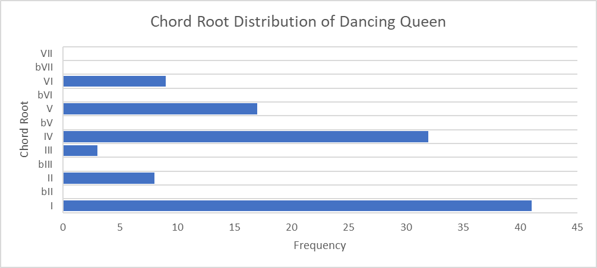
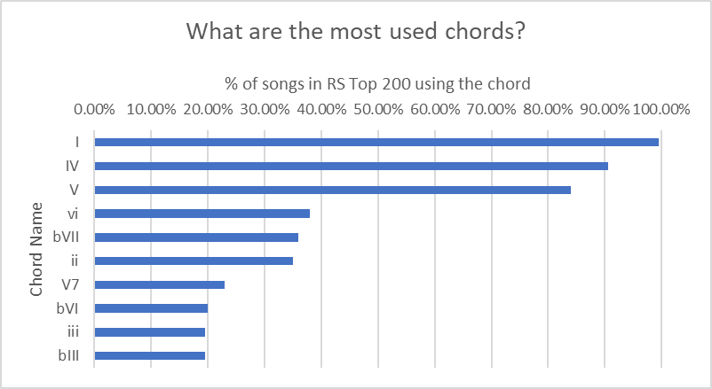
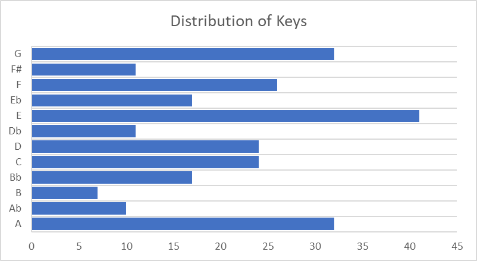


*This is an older post that I've brought over from my previous portfolio site - which I'd hosted on GitHub pages. I would have made this after finishing my MSc, but before getting my offer at Scarlatti, which dates this to 2023.*

*It's interesting to look back at how I went about it back then - I've certainly come a long way (especially in graph styling, I'm not a huge fan of those default styled Excel graphs...). I've totally forgotten about that PowerQuery folder import option - every time I need to batch process data files, I reach for Python nowadays.*

*If (for some reason I can't fathom) you want to look at the spreadsheet, here's the link. But I warn you, there is no contents page, no nice narrative. Just raw tables, and pivot charts!*




# Data source

This project uses data from [*A Corpus Study of Rock Music*, by Trevor de Clerq and David Temperley](http://rockcorpus.midside.com/index.html). This project analysed the top 200 songs from the [Rolling Stone magazine's](https://www.rollingstone.com/) list of the ["500 Greatest Songs of All Time"](http://web.archive.org/web/20080622145429/www.rollingstone.com/news/coverstory/500songs), providing a transcription of the melody and a harmonic analysis. I will be importing and cleaning this data into excel.

There are two main parts to the data:

- rs200.csv, which holds data about the songs such as the title and artist.
- The harmonic analysis data. This holds the chord data, and each song has its own file.

# RS200.csv

Trevor and David have provided a csv file, `RS200.csv`, with data about the releases. This part of the data is very easy to clean, after importing with Power Query, all we need to do is set the column titles. I have removed the last column in the file, which stated if the song was present in a previous dataset. This isn't needed for our analysis. The before and after of this file can be seen below.


# Chord Data

Trevor and David have provided the chord data a file for each song. There are two versions of each file, one ending in \_dt, one ending in \_tdc. This is because both Trevor and David did the harmonic analysis for each song. Since chord sequences can be subjective, there may be differences between their analysis.



Each file contains timing and harmonic data. For example, the first few lines of 1999_dt.clt are,

```
18.774	7.00	I64	0	1	5	5
19.784	7.50	V11	7	5	5	0
20.795	8.00	I64	0	1	5	5
21.812	8.50	V11	7	5	5	0
22.830	9.00	I64	0	1	5	5
23.838	9.50	V11	7	5	5	0
24.847	10.00	I64	0	1	5	5
```

To all this data from individual files by import each one would be a pain. Fortunately, Excel's PowerQuery has just the tool to deal with this:

## Bulk importing in Power Query


This automates most of the hard work to import and merge all these files. Excel autodetects the data format perfectly in this case. And after a little renaming of columns, (and sorting to show that the data from each file has indeed been merged) we get the following,


### Splitting the filename into its components

There's one last thing to do before we can import this into the work sheet. The filename field effectively contains two fields worth of data: the song id as appears in RS200.csv, and the person who did the analysis.

Before parsing the filename text, I duplicated the column. This way I could be sure to keep the original filename data. Then, I split the column by the last "\_" delimiter to separate the song id from the author initials. Finally, I removed the .clt extension by extracting the text before the delimiter. These operations can be found in PowerQuery in the transform tab, as seen below.




In general, you need to be careful when parsing text like this. If the delimiters aren't exactly where you expect them, then the text won't split like you expect. In this case the filenames are structured enough that we can be sure of exactly how it will split.

There we go, we've successfully imported, aggregated, and cleaned our data. The final table of chord data has 36,970 rows. PowerQuery made that much easier than it had any right to be. With this data we can perform some analysis. For example, visualising the chords of a single song.





Or, analysing data from all songs to find trends in what chords or keys are popular.





There's a lot of interesting stuff you could do with this data. But since this project was just about aggregating and cleaning data I'll leave it here. Perhaps in the future I'll come back and find patterns or insights in this data. Such as what cadences are popular, or how use of certain keys/chords change over time. If you want to have a play with the spreadsheet, you can find a link to it at the top of the page.
