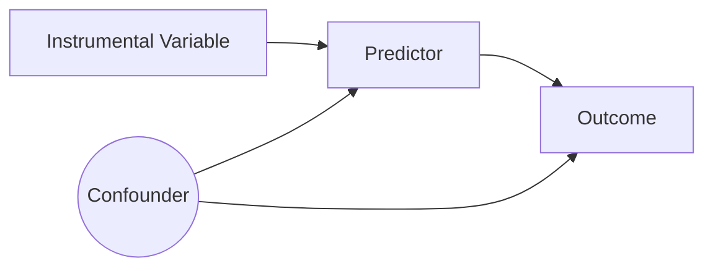
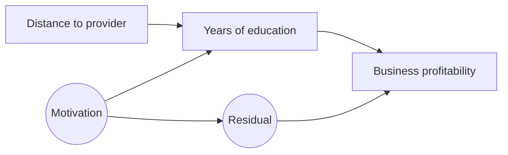

In my work I'm regularly dealing with questions that have a causal nature. These are questions like,

- Can investing in employee training increase a business's profitability or production?
- In a university or polytech, what are the effects of first year support programmes on overall qualification completion rates?

Through sources such as the Stats NZ IDI we can sometimes get data describing these situations, but establishing a causal link is difficult. Confounders can enhance or reduce correlations between the predictors and the outcome through pathways that aren't the intended causal link. For example, take the example of how employee education affects business profits. Theoretically a more trained employee might be more productive because of their training, which could improve profits. But a person who is particularly motivated may also improve profits and have higher education, but in part because motivation is causally influences both of these.

This can be an issue when forecasting the effects of interventions. If we simply took a regression between years of education and business profits, we might be overestimating the effects of interventions which fund training. If these interventions cause random uptake of training rather than uptake being depending on the employee's motivation, the actual effect of the intervention will be less than we forecast.

If we could somehow measure motivation we could try to control for it. And while that might be possible with latent factor analysis, that's only one confounder. We not only have to contend with the known unknowns, but the [unknown unknowns](https://en.wikipedia.org/wiki/There_are_unknown_unknowns).

# Background - Instrumental variables {#backgroundinstrumental-variables}

One possibility to help with this is instrumental variables. The idea is that we introduce a variable which is causally linked to our outcome only through our predictor of interest. Thus, any correlation between the instrumental variable and the outcome is solely due to the causal link of interest.

This instrumental variable needs to satisfy the following rules in order to make our regression analysis actually get at the causal link:

1. **Relevance**; the instrumental variable must have a strong relationship with the predictor.
2. **Exogeneity**; the instrumental variable must be uncorrelated with the residual in our outcome. Effectively, this means the instrumental variable must only be causally linked to the outcome through our parameter of interest.

The second condition is usually much hard to meet; it is hard to test for, so tends to rely on arguments made by the author. Ideally, the instrumental variable would be assigned at random.

In our example of the effect of education on business profitability, we might examine proximity to a tertiary education institution. We satisfy relevance as someone living close to a university will be more likely to attend that university, and so have more years of education. An argument for exogeneity might be that within a city with multiple tertiary education providers, proximity to them is somewhat randomly assigned, so we may expect it to be independent of our residual term.


This is not a particularly strong argument for exogeneity. For example, university professors have a strong incentive to live close to their university. So a student who lives close to a university is more likely to be a child of a professor, which will have implications for confounders such as socioeconomic status.\
This isn't the end for using this instrumental variable, we could use it as long as we are able to control for the confounding pathways such as this one. But we need to know and measure these confounding effects, or we're back where we started.


If we believe this argument for relevance and exogeneity, then two-stage least squares can give an unbiased estimation of the causal effect of education on business profitability. The instrumental variable forms a natural experiment of sorts which can even help control for the unknown unknowns.

# Exploration with synthetic data

{{< bookmark
  url="https://github.com/finn-okeeffe/instrumental-variables-notebook"
  title="GitHub - finn-okeeffe/instrumental-variables-notebook: An exploration of instrumental variables and two stage least squares using synthetic data."
  description="An exploration of instrumental variables and two stage least squares using synthetic data. - finn-okeeffe/instrumental-variables-notebook"
  icon="/content/images/icon/pinned-octocat-093da3e6fa40-2.svg"
  author="finn-okeeffe"
  publisher="GitHub"
  thumbnail="/content/images/thumbnail/instrumental-variables-notebook.png"
>}}

In the above repo, I explore instrumental variables using some synthetic data with the years of education example we've been exploring so far.

I generated synthetic data following the example before, generating a latent motivation factor using a standard normal and similarly generating years of education and residual effects. Years of education and profitability was generated following the model, with a true effect size of

\[\beta = \$500 / \text{year} \]

However, if we naively apply OLS to estimate the effect, we get \(\hat{\beta} = \$668 / \text{year}\) with a 95% confidence interval of \((\$646 / \text{year}, \$691 / \text{year})\). We're overestimating the causal effect.

So let's try again with our instrumental variable.

Using 2SLS (I used the [statsmodels implementation](https://www.statsmodels.org/stable/generated/statsmodels.sandbox.regression.gmm.IV2SLS.html)), we estimate \(\hat{\beta} = \$516/\text{year}\) with a 95% confidence interval of \((\$443 / \text{year}, \$589 / \text{year})\). Much better!

I plotted this naive slope and actual slope on a single plot below to get an idea of the difference. Note that the red line using the 2SLS slope isn't meant to be an accurate prediction for profitability, since we've purposely removed the effect of motivation. This is purely just to demonstrate the difference in our slope estimates.

# Caveats for real world application

Finding instrumental variables which satisfy the exogeneity question can be difficult, and the strength of your resulting causal inference will depend on the strength of the argument for exogeneity. And these are very hard to find, and very hard to justify.

> **Patrick Curran:** I actually saw an instrumental variable. It was riding a unicorn, and it was licking a rainbow.

[*Quantitude — S6E10 Instrumental Variables (Dad)Rock!*](https://open.spotify.com/episode/3k8MXmocl478aj9Eud4sQx?si=12905ef2149745c6)
